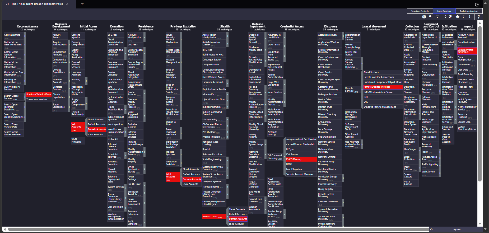

# 🚨 Incident Analysis: The Friday Night Breach (Windows Ransomware)

---

## 1. Executive Summary

During a 48-hour intrusion window, a threat actor compromised a healthcare organization's Windows enterprise network by leveraging leaked VPN credentials purchased from a dark web forum. Rather than exploiting software vulnerabilities, the adversary blended in using legitimate administrative pathways—dumping Domain Administrator credentials from LSASS memory, moving laterally via Remote Desktop Protocol (RDP) to critical database servers, and deploying ransomware across the environment to encrypt patient records.

---

## 2. Attack Heatmap (MITRE ATT&CK Navigator)

> **Visual Reference:** The matrix layer below highlights all tactics and sub-techniques observed during this intrusion. *(Interactive JSON layer included in `./attack-navigator-layer.json`)*

---

## 3. MITRE ATT&CK Kill Chain Mapping

| Stage | Tactic | Technique Name | Technique ID | Observed Evidence & Adversary Behavior |
| :--- | :--- | :--- | :--- | :--- |
| **0** | **Reconnaissance** | Search Closed Sources: Purchase Technical Data | `T1597.002` | Adversary purchased leaked employee VPN credentials from a dark web marketplace prior to active network contact. |
| **1** | **Initial Access** | Valid Accounts | `T1078` | Authenticated directly into the corporate VPN gateway using valid employee credentials, bypassing perimeter vulnerability scanning or exploit payloads. |
| **2** | **Credential Access** | OS Credential Dumping: LSASS Memory | `T1003.001` | Executed **Mimikatz** on the compromised employee workstation to extract cleartext/hash credentials of a Domain Administrator from `lsass.exe` process memory. |
| **3** | **Privilege Escalation** | Valid Accounts: Domain Accounts | `T1078.002` | Leveraged the newly harvested Domain Administrator credentials to elevate privileges across the Active Directory domain. |
| **4** | **Lateral Movement** | Remote Services: Remote Desktop Protocol | `T1021.001` | Initiated an interactive RDP session from the standard user workstation directly to the internal database server using the stolen admin account. |
| **5** | **Impact** | Data Encrypted for Impact | `T1486` | Deployed ransomware binary across connected Windows servers, encrypting critical healthcare databases and halting clinical operations. |

---

## 4. Blue Team Detection Engineering (SOC Telemetry)

To detect this attack chain prior to **Stage 5 (Impact)**, SOC analysts should monitor the following Windows and Endpoint Detection & Response (EDR) telemetry sources:

### 🔍 Stage 1: Anomalous VPN Logons (`T1078`)
* **Telemetry Source:** VPN Gateway Logs & Windows Security Event Log (`Event ID 4624` - Successful Logon).
* **Detection Logic:** Alert on impossible travel, logins from anomalous ASN/Tor exit nodes, or employee VPN logins occurring outside normal shift hours without Multi-Factor Authentication (MFA).

### 🔍 Stage 2: LSASS Memory Credential Dumping (`T1003.001`)
* **Telemetry Source:** Sysmon (`Event ID 10` - ProcessAccess) & Windows Defender / EDR.
* **Detection Logic:** Trigger a high-severity alert when any non-system process (such as `mimikatz.exe` or an unsigned binary) requests `PROCESS_VM_READ` (`GrantedAccess: 0x1010` or `0x1410`) against `C:\Windows\System32\lsass.exe`.

### 🔍 Stage 4: Internal Workstation-to-Server RDP (`T1021.001`)
* **Telemetry Source:** Windows Security Event Log (`Event ID 4624` with `Logon Type 10` - RemoteInteractive, and `Event ID 4648` - Explicit Credentials).
* **Detection Logic:** Baseline normal administrative jump hosts. Alert immediately when a standard non-IT workstation initiates an RDP session (`TCP/3389`) to a Tier-0/Tier-1 database server.

---

## 5. Remediation & Hardening Recommendations

1. **Enforce Phishing-Resistant MFA (`T1078`):** Require Multi-Factor Authentication on all external VPN gateways so leaked credentials alone cannot grant initial access.
2. **Enable LSA Protection & Credential Guard (`T1003.001`):** Configure Windows Defender Credential Guard and enable `RunAsPPL` (Protected Process Light) on `lsass.exe` to prevent user-mode tools like Mimikatz from reading process memory.
3. **Restrict Domain Admin Logons (`T1078.002`):** Implement Microsoft's Tiered Administration Model so Domain Administrators never log into standard employee workstations where their credentials can be cached in memory.
4. **Network Segmentation for RDP (`T1021.001`):** Block internal `TCP/3389` traffic from standard user VLANs to server VLANs, forcing administrators to use hardened Privileged Access Workstations (PAWs).
5. **Immutable Offline Backups (`T1486`):** Maintain air-gapped, immutable backups following the 3-2-1-1-0 rule to guarantee recovery without paying ransom.
