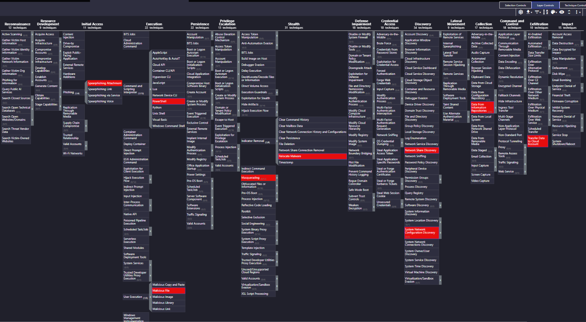

# 🕵️ Incident Analysis: The Silent Data Leak (Corporate Espionage)

---

## 1. Executive Summary

A threat actor conducted a stealthy corporate espionage campaign targeting a financial consulting firm's Chief Financial Officer (CFO) to steal confidential merger plans. The adversary gained a foothold via a macro-enabled Excel lure disguised as a legitimate invoice, executed an obfuscated PowerShell payload, and immediately cleared Windows Security Event Logs to cover their tracks. After enumerating internal network shares, the attacker blended Command and Control (C2) traffic into standard HTTPS web protocols and exfiltrated sensitive documents directly to a third-party cloud storage account (Google Drive) to evade traditional perimeter alerts.

---

## 2. Attack Heatmap (MITRE ATT&CK Navigator)

> **Visual Reference:** The matrix layer below highlights all tactics and sub-techniques observed during this espionage campaign. *(Interactive JSON layer included in `./attack-navigator-layer.json`)*

---

## 3. MITRE ATT&CK Kill Chain Mapping

| Stage | Tactic | Technique Name | Technique ID | Observed Evidence & Adversary Behavior |
| :--- | :--- | :--- | :--- | :--- |
| **1** | **Initial Access** | Phishing: Spearphishing Attachment | `T1566.001` | Delivered a targeted email to the CFO containing a malicious macro-enabled workbook (`Invoice_2026.xlsm`). |
| **2** | **Defense Evasion** | Masquerading | `T1036` | Disguised the malicious `.xlsm` macro payload as a routine financial invoice (`.xlsx` convention) to deceive the victim into trusting the file. |
| **3** | **Execution** | User Execution: Malicious File | `T1204.002` | Victim opened the attachment and clicked **"Enable Content"**, triggering the embedded VBA macro. |
| **4** | **Execution** | Command and Scripting Interpreter: PowerShell | `T1059.001` | The VBA macro spawned a hidden `powershell.exe` process in the background to stage post-exploitation tasks. |
| **5** | **Defense Evasion** | Indicator Removal: Clear Windows Event Logs | `T1070.001` | Cleared the Windows Security Event Log immediately after execution to erase forensic evidence of initial compromise. |
| **6** | **Discovery** | System Network Configuration Discovery | `T1016` | Executed `ipconfig /all` to map local IP subnets, DNS servers, and internal network topology. |
| **7** | **Discovery** | Network Share Discovery | `T1135` | Executed `net view` to enumerate accessible SMB file shares across the corporate network hosting merger documents. |
| **8** | **Command & Control** | Application Layer Protocol: Web Protocols | `T1071.001` | Encapsulated C2 heartbeats and tasking inside standard encrypted **HTTPS** traffic to blend in with normal user web browsing. |
| **9** | **Exfiltration** | Exfiltration Over Web Service: Exfiltration to Cloud Storage | `T1567.002` | Uploaded compressed merger archives directly to an external **Google Drive** account rather than an attacker-controlled IP, bypassing reputation-based firewall blocks. *(Note: Also aligns with `T1537` Transfer Data to Cloud Account in cloud-native contexts).* |

---

## 4. Blue Team Detection Engineering (SOC Telemetry)

Even though this adversary avoided noisy exploit payloads and used trusted web services, defenders can catch this intrusion at multiple points in the kill chain:

### 🔍 Stage 4: Office Spawning PowerShell (`T1059.001`)
* **Telemetry Source:** Sysmon (`Event ID 1` - Process Creation) & Windows Security (`Event ID 4688`).
* **Detection Logic:** Alert whenever a Microsoft Office parent process (`EXCEL.EXE`, `WINWORD.EXE`) spawns a command-line interpreter (`powershell.exe`, `cmd.exe`, `wscript.exe`). Legitimate spreadsheets almost never launch PowerShell.

### 🔍 Stage 5: Audit Log Clearing (`T1070.001`)
* **Telemetry Source:** Windows Security Event Log (`Event ID 1102` - *The audit log was cleared*) & System Log (`Event ID 104`).
* **Detection Logic:** Treat any occurrence of `Event ID 1102` on a user workstation as a **Critical/High-Priority** incident, as standard employees never clear local security event logs.

### 🔍 Stage 6 & 7: Rapid Recon Command Burst (`T1016` & `T1135`)
* **Telemetry Source:** Sysmon (`Event ID 1`) / EDR Command-Line Auditing.
* **Detection Logic:** Trigger a behavioral correlation alert when built-in discovery utilities (`ipconfig.exe`, `net.exe`, `whoami.exe`, `nltest.exe`) execute sequentially within a 60-second window under a non-IT user context.

### 🔍 Stage 9: Unsanctioned Cloud Storage Exfiltration (`T1567.002`)
* **Telemetry Source:** Secure Web Gateway (SWG) / Cloud Access Security Broker (CASB) / Proxy Logs.
* **Detection Logic:** Monitor outbound TLS/HTTPS POST upload volumes to personal cloud storage domains (`://google.com`, `dropbox.com`, `mega.nz`) and flag anomalous multi-gigabyte uploads occurring outside business hours.

---

## 5. Remediation & Hardening Recommendations

1. **Block Internet Macros by Default (`T1204.002` & `T1059.001`):** Enable Microsoft Office Group Policy settings to block VBA macros from running in files downloaded from the internet (Mark-of-the-Web / MOTW enforcement).
2. **Deploy Attack Surface Reduction (ASR) Rules:** Enable Microsoft Defender ASR rule *"Block all Office applications from creating child processes"* to stop `EXCEL.EXE` from spawning `powershell.exe`.
3. **Centralize Log Forwarding (`T1070.001`):** Stream Windows Event Logs and Sysmon telemetry in real time to a centralized SIEM (e.g., Wazuh / Splunk) so clearing local workstation logs does not destroy forensic evidence.
4. **Enforce Cloud DLP & Tenant Restrictions (`T1567.002`):** Configure corporate web proxies to block uploads to personal Google Drive/consumer cloud accounts while restricting access strictly to the organization's corporate workspace tenant.
