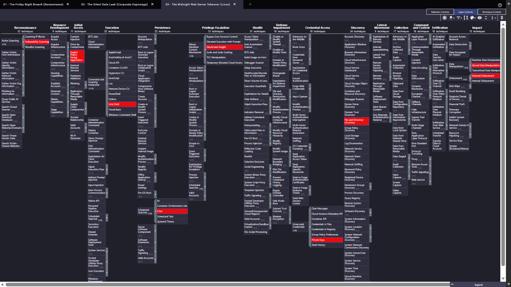

# 🐧 Incident Analysis: The Midnight Web Server Takeover (Linux & Web Infrastructure)

---

## 1. Executive Summary

An e-commerce startup suffered a full Linux web server compromise after an adversary discovered and exploited an unpatched SQL Injection vulnerability in the public-facing authentication portal. After gaining remote command execution as the low-privilege `www-data` web user, the attacker established reboot-resilient persistence via a malicious `cron` job, enumerated and abused a misconfigured SUID binary to escalate privileges to `root`, harvested private SSH keys for lateral movement, and modified the web application to skim customer payment data while defacing the homepage.

---

## 2. Attack Heatmap (MITRE ATT&CK Navigator)

> **Visual Reference:** The matrix layer below highlights all tactics and sub-techniques observed across the Linux web server intrusion. *(Interactive JSON layer included in `./attack-navigator-layer.json`)*

---

## 3. MITRE ATT&CK Kill Chain Mapping

| Stage | Tactic | Technique Name | Technique ID | Observed Evidence & Adversary Behavior |
| :--- | :--- | :--- | :--- | :--- |
| **0** | **Reconnaissance** | Active Scanning: Vulnerability Scanning | `T1595.002` | Conducted automated web vulnerability scanning against the public e-commerce portal to identify exploitable flaws. |
| **1** | **Initial Access** | Exploit Public-Facing Application | `T1190` | Exploited an unpatched SQL Injection vulnerability in the web login form to bypass authentication controls. |
| **2** | **Execution** | Command and Scripting Interpreter: Unix Shell | `T1059.004` | Leveraged the web application flaw to execute OS-level `/bin/sh` and `/bin/bash` commands under the `www-data` service account. |
| **3** | **Persistence** | Scheduled Task/Job: Cron | `T1053.003` | Injected a scheduled reverse-shell payload into the system `crontab` to re-establish external C2 access every 15 minutes across reboots. |
| **4** | **Discovery** | File and Directory Discovery | `T1083` | Enumerated the Linux filesystem (e.g., `find / -perm -4000 2>/dev/null`) to locate binaries configured with SUID permissions. |
| **5** | **Privilege Escalation** | Abuse Elevation Control Mechanism: Setuid and Setgid | `T1548.001` | Exploited a misconfigured SUID binary to escalate privileges from `www-data` to full `root` administrator. |
| **6** | **Credential Access** | Unsecured Credentials: Private Keys | `T1552.004` | Accessed `/root/.ssh/` and exfiltrated the administrator's private SSH key (`id_rsa`) to enable passwordless lateral movement (`T1021.004`). |
| **7** | **Impact** | Data Manipulation: Stored Data Manipulation | `T1565.001` | Altered backend checkout source code on disk to inject a malicious payment card skimmer. |
| **8** | **Impact** | Defacement: External Defacement | `T1491.002` | Replaced the public-facing index page HTML to display an unauthorized political message, damaging brand reputation. |

---

## 4. Blue Team Detection Engineering (Linux Telemetry)

Defenders monitoring Linux servers via `auditd`, syslog, or a SIEM/XDR platform (such as **Wazuh**) can detect this intrusion across multiple stages:

### 🔍 Stage 1 & 2: Web Server Spawning Interactive Shells (`T1190` & `T1059.004`)
* **Telemetry Source:** Linux `auditd` (`EXECVE` syscall logs) & Web Server Access/Error Logs (`/var/log/nginx/access.log` or `/var/log/apache2/access.log`).
* **Detection Logic:** Trigger a high-severity alert whenever the web daemon user (`www-data`, `nginx`, or `apache`) spawns a shell interpreter (`/bin/sh`, `/bin/bash`, `python`, `nc`, `curl`, `wget`). Web servers should never execute shell commands.

### 🔍 Stage 3: Unauthorized Crontab Modification (`T1053.003`)
* **Telemetry Source:** `/var/log/cron` or `/var/log/syslog` (`CRON` daemon entries) & File Integrity Monitoring (FIM).
* **Detection Logic:** Monitor `/etc/crontab`, `/etc/cron.d/*`, and `/var/spool/cron/crontabs/*` for write events or new scheduled jobs containing network utilities (`nc`, `bash -i`, `/dev/tcp/`, `curl`).

### 🔍 Stage 5: SUID Privilege Escalation (`T1548.001`)
* **Telemetry Source:** Linux `auditd` privilege escalation rules (`auid!=uid` where `euid=0`).
* **Detection Logic:** Alert when a low-privilege service account (`www-data`) executes a SUID binary that transitions effective UID (`euid`) to `0` (`root`).

### 🔍 Stage 6, 7 & 8: Critical File Access & Web Root Tampering (`T1552.004`, `T1565.001`, `T1491.002`)
* **Telemetry Source:** Wazuh File Integrity Monitoring (FIM) / `auditd` file watch rules (`-w`).
* **Detection Logic:** Configure real-time FIM alerts on `/root/.ssh/` read/copy operations and any unauthorized checksum/hash modifications inside `/var/www/html/`.

---

## 5. Remediation & Hardening Recommendations

1. **Eliminate SQL Injection (`T1190`):** Refactor database queries to use parameterized statements (prepared statements) and deploy a Web Application Firewall (WAF) to block SQLi payloads.
2. **Audit & Strip Unnecessary SUID Bits (`T1548.001`):** Regularly audit SUID/SGID binaries across production servers and remove the SUID bit (`chmod u-s`) from any non-essential utilities.
3. **Restrict Crontab Access (`T1053.003`):** Enforce `/etc/cron.allow` to explicitly whitelist only authorized administrative accounts, blocking service accounts like `www-data` from scheduling jobs.
4. **Enforce SSH Key Passphrases & Host Restrictions (`T1552.004`):** Protect private SSH keys (`id_rsa`) with strong passphrases, disable direct `root` SSH login (`PermitRootLogin no`), and restrict internal SSH access using firewall allowlists.
5. **Immutable Web Root (`T1565.001` & `T1491.002`):** Mount production web application directories as read-only where possible and deploy automated integrity verification against a trusted Git repository.
